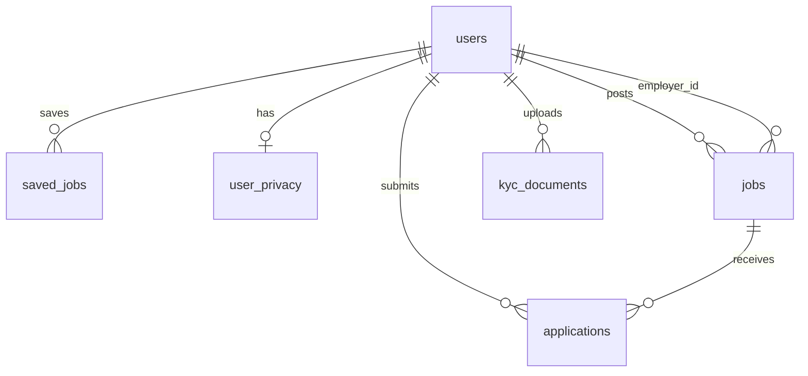

# OpenJobs — Backend schema & data access

**Database:** SQLite (`jobs.db` or `DATABASE_URL`)  
**Last updated:** October 2026

---

## 1. Entity relationship (core)

---

## 2. Tables

### `users`

| Column | Type | Notes |
|--------|------|--------|
| id | INTEGER PK | |
| name, email | TEXT | Email unique |
| password_hash | TEXT | bcrypt |
| role | TEXT | `user`, `employer`, `admin` |
| phone, skills, resume_text | TEXT | Profile |
| preferred_location, experience | TEXT | |
| employer_id / company fields | TEXT | Employer org context |
| kyc_status | TEXT | pending / submitted / verified |
| created_at | TEXT | ISO |

**Who can read:** Self; admin (email masked if `ADMIN_MASK_PII`); employers see applicants only via `applications` join.

### `jobs`

| Column | Type | Notes |
|--------|------|--------|
| id | INTEGER PK | |
| title, company, location, description | TEXT | Required on create |
| salary, salary_min, salary_max, salary_currency | | Display + filters |
| work_type, work_arrangement, category | TEXT | |
| skills, search_summary | TEXT | Search + dedupe for scrapers |
| is_active, is_featured | INTEGER | Soft delete / highlight |
| employer_id | INTEGER FK → users | Nullable for scraped jobs |
| view_count, application_count | INTEGER | Analytics |
| expires_at, created_at | TEXT | |
| selling_points, video_url | TEXT | JSON / URL |

**Who can read:** Public (active jobs); employer (own rows); admin all.

### `applications`

| Column | Type | Notes |
|--------|------|--------|
| id | INTEGER PK | |
| job_id, user_id | INTEGER FK | Unique pair (migration index) |
| status | TEXT | pipeline stage |
| resume_text, cover_letter | TEXT | |
| match_score | REAL | ATS-style |
| applied_at, updated_at | TEXT | |

**Who can read:** Seeker (own); employer (jobs they own); admin.

### `saved_jobs`

| user_id, job_id | PK composite | saved_at |

**Who can read/write:** Owner only (`request.user_id`).

### `skills_taxonomy`

| name | PK | aliases, category, demand_score |

**Who can read:** Public read for matching UI.

### `job_alerts`, `notifications`

Alert preferences and in-app notifications (per user).

### `kyc_documents`

| user_id, doc_type | | file_path, status |

**Who can read:** Owner; admin verify endpoints.

### `user_privacy` (migration 002)

| user_id | PK |
| marketing_opt_in, analytics_opt_in | INTEGER 0/1 |
| updated_at | TEXT |

**Who can read/write:** Owner; export includes row.

### `schema_migrations`

Applied SQL migration filenames.

### `idempotency_keys` (migration 001)

| key, user_id, route | PK | response_body, status_code, created_at |

**Purpose:** Safe retries on `POST /api/apply/<id>`.

### CRM / AI (if present)

- `crm_*` tables — admin only APIs  
- `ai_usage` — token logging for Ollama calls

---

## 3. Files on disk (not SQL)

| Path | Content | Access |
|------|---------|--------|
| `uploads/` | Resume files (transient) | Owner; deleted after text extract when possible |
| `kyc_uploads/` | ID documents | Owner + admin |
| Scraped refs in `search_summary` | `seek:123`, `nsw_jobfeed:hash` | Dedup on ingest |

---

## 4. API ↔ data mapping (sensitivity)

| Data class | Examples | Storage | Encryption |
|------------|----------|---------|------------|
| Public | Job titles, descriptions | `jobs` | TLS in transit |
| PII | Email, name, phone | `users`, `applications` | TLS; at-rest = host volume |
| Auth secrets | password_hash, JWT | hash only / client token | Never log JWT |
| Payments | Stripe IDs | Stripe (not full PAN in DB) | PCI via Stripe |
| Chat | Messages | Not persisted by default | N/A |

---

## 5. Row-level access rules (enforced in `api/server.py`)

| Role | Jobs | Applications | Users |
|------|------|--------------|-------|
| Guest | Read active | — | — |
| Seeker | Read | Own only | Own profile |
| Employer | Own jobs CRUD | For own job_ids | Own profile |
| Admin | All | All | All (PII masked optional) |

---

## 6. Indexes (P1 migrations)

- `jobs(is_active, created_at)`, `jobs(is_featured)`, `jobs(location)`  
- `applications(user_id)`, `applications(job_id)`, unique `(job_id, user_id)`  
- `users(email)`

---

## 7. Future schema (Postgres)

- Alembic migrations; `JSONB` for selling_points  
- Partition or archive old `applications`  
- Separate read replica for analytics
