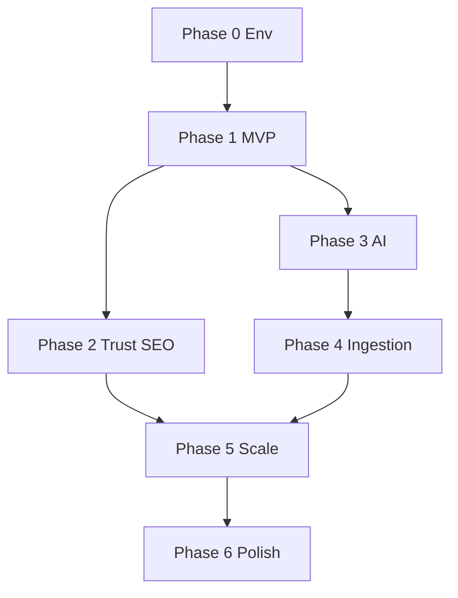

# OpenJobs — Implementation plan (build order)

**Purpose:** Suggested sequence for greenfield or hardening an existing deploy.  
**Last updated:** October 2026

---

## Phase 0 — Foundation (week 0)

| # | Work | Owner | Depends on |
|---|------|-------|------------|
| 0.1 | Repo clone, `.env` from `.env.example`, `pip install -r requirements.txt` | Dev | — |
| 0.2 | Seed or restore `jobs.db` with schema + sample data | Dev | — |
| 0.3 | `PYTHONPATH=. python api/server.py` smoke test | Dev | 0.1 |
| 0.4 | Set `JWT_SECRET`, `APP_URL`, `CONTACT_*` for environment | Ops | — |

**Exit:** Home loads, `GET /api/jobs` returns JSON.

---

## Phase 1 — Core product (MVP)

| # | Work | Priority | Notes |
|---|------|----------|-------|
| 1.1 | Auth (register/login/me/logout) | P0 | Already in repo |
| 1.2 | Job CRUD + public search | P0 | |
| 1.3 | Apply + applications list | P0 | Idempotency on apply |
| 1.4 | Seeker `/user` dashboard | P0 | |
| 1.5 | Employer `/employer` + kanban | P0 | |
| 1.6 | Email SMTP in production | P1 | SendGrid |
| 1.7 | Stripe live keys + webhook verify | P1 | Roadmap item |

**Exit:** End-to-end hire on staging with real email.

---

## Phase 2 — Trust, SEO & compliance

| # | Work | Priority | Notes |
|---|------|----------|-------|
| 2.1 | Privacy, terms, 404, thank-you | P0 | PR #8 |
| 2.2 | Cookie banner + GA4 opt-in | P1 | `site.js` |
| 2.3 | Security audit fixes (admin, IDOR) | P0 | `notes/SECURITY_AUDIT.md` |
| 2.4 | Data export / delete account | P0 | GDPR-style |
| 2.5 | `robots.txt` + sitemaps on prod domain | P1 | `APP_URL` |
| 2.6 | Per-job SEO meta | P1 | Jinja `job.html` |

**Exit:** Legal pages live; penetration re-test on auth routes.

---

## Phase 3 — AI & engagement

| # | Work | Priority | Notes |
|---|------|----------|-------|
| 3.1 | Ollama deploy (sidecar or hosted) | P2 | Keyword-first matcher stays default |
| 3.2 | Resume upload → skills → recommendations | P1 | |
| 3.3 | Web chatbot (rule-based) | P1 | `FEATURE_CHATBOT` |
| 3.4 | Telegram bot + token rotation | P2 | |
| 3.5 | Guest ads + feature flags | P2 | |

**Exit:** Dashboard “For You” with AI off degrades gracefully.

---

## Phase 4 — Data ingestion (Australia)

| # | Work | Priority | Notes |
|---|------|----------|-------|
| 4.1 | NSW JobFeed scraper | P2 | Official feed |
| 4.2 | All-states teaching mobility scan | P2 | PR #7 |
| 4.3 | Dedup + `listed_at` column | P2 | Improve freshness |
| 4.4 | QLD/VIC DET adapters | P3 | When HTML/API stable |

**Exit:** Scheduled admin scrape weekly; jobs tagged by `source`.

---

## Phase 5 — Platform scale

| # | Work | Priority | Notes |
|---|------|----------|-------|
| 5.1 | Docker deploy on Railway/Render | P1 | |
| 5.2 | Redis for limiter + cache | P2 | |
| 5.3 | Postgres migration | P2 | |
| 5.4 | CDN (Cloudflare) + cache gen header | P2 | `platform_cache.py` |
| 5.5 | CI: lint, migrate gate, staging deploy | P2 | |
| 5.6 | OTEL / alerting | P3 | `notes/ENGINEERING_ROADMAP.md` |

**Exit:** Autoscale web tier; p95 SLO monitored.

---

## Phase 6 — Polish & growth

| # | Work | Priority | Notes |
|---|------|----------|-------|
| 6.1 | Fix nav dead links (`/learning`, companies template) | P2 | |
| 6.2 | `user.html` / `admin.html` cookie + meta parity | P3 | |
| 6.3 | PNG favicon + multi-size OG image | P3 | |
| 6.4 | Employer self-serve analytics export | P3 | |
| 6.5 | Mobile app or PWA | P4 | Out of scope until web stable |

---

## Dependency graph (simplified)

---

## Definition of done (release)

- [ ] All P0 security items closed  
- [ ] `APP_URL` production domain on all canonicals  
- [ ] `/api/ready` green in prod  
- [ ] Privacy/terms/contact accurate  
- [ ] Backup + restore tested for DB  
- [ ] Runbook for rollback (Railway/GitHub)

---

## Document set (this package)

| # | File |
|---|------|
| 1 | `docs/01-product-requirements.md` |
| 2 | `docs/02-technical-requirements.md` |
| 3 | `docs/03-app-flow.md` |
| 4 | `docs/04-design-brief.md` |
| 5 | `docs/05-backend-schema.md` |
| 6 | `docs/06-implementation-plan.md` |
